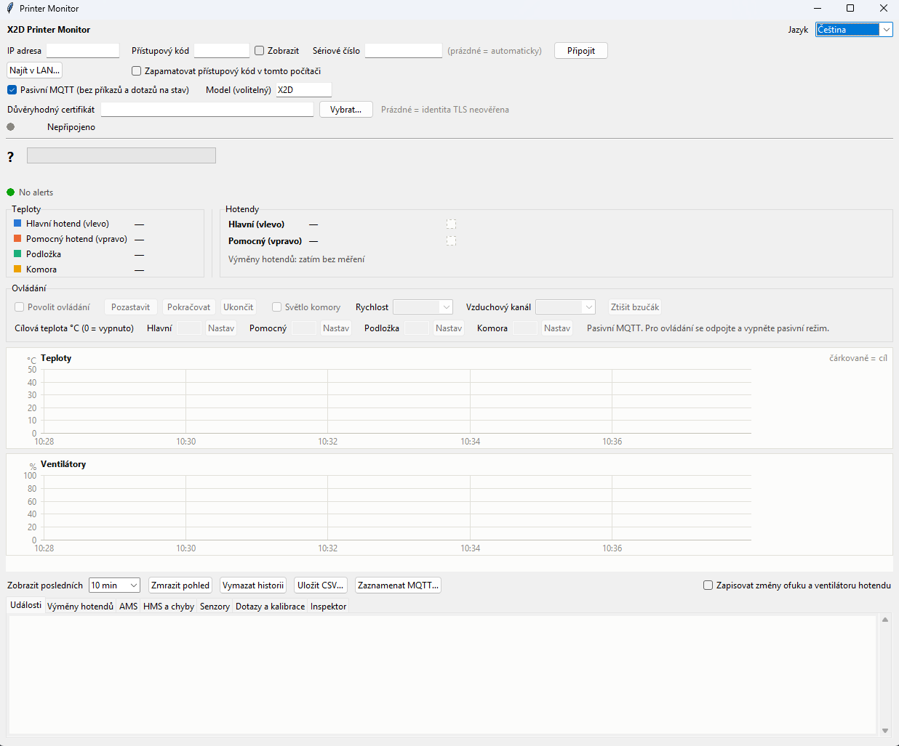

# X2D Printer Monitor

Live status window for a **Bambu Lab X2D** on your local network. It shows temperatures, fans, both hotends, the AMS and alerts, with charts, and measures how long each hotend switch takes.

It works without Bambu Studio, Bambu Handy or the cloud. The window defaults to **Passive MQTT**: it subscribes to reports and sends no commands or status requests. Disconnect and turn off Passive MQTT to allow full-status requests and read queries. It can also pause, resume or stop a print and set the light, speed, air duct mode and target temperatures, but only after you additionally tick **Enable controls** (see [Controls](#controls)).



## What you get

- **Status:** print state, progress, layer, time left, current stage (heating, changing filament, cleaning nozzle…), speed mode, and how often the printer sends updates.
- **Temperatures:** both hotends, bed and chamber, with their targets.
- **Fans:** part cooling, left and right auxiliary fans, chamber exhaust, hotend fan, and the others the printer reports, in percent.
- **Hotends:** for Main (left) and Aux (right): nozzle size, flow type and material, the loaded filament (colour, type, AMS slot, amount left), and what the hotend is doing.
- **Hotend switch timing:** every switch with its duration, the time since the previous switch, the layer, and the steps the printer reported. Also a summary: count, last, average, min/max, and total time spent switching.
- **Charts:** temperature and fan history for the last 2 min to 2 h, or everything. Dotted lines mark hotend switches. A band under the fan chart shows which hotend was active. Hover to read values, and click a legend entry to hide or show a line.
- **AMS:** every unit with temperature, humidity and drying state, and every slot with colour, material and remaining amount. Slots that feed a hotend are marked.
- **Alerts:** HMS alerts and print errors, with Bambu Studio's English message text when available.
- **Controls** (optional): pause, resume, stop, chamber light, speed, air duct mode, target temperatures, silence the buzzer.
- **Export:** **Save CSV…** saves the recorded history (one row per second, up to 12 hours) plus a separate file of hotend switches. **Record raw…** saves every message the printer sends, for later analysis.

## Before you start

1. **Printer in LAN mode.** In the printer's network settings, turn on **LAN Only Mode**. Developer Mode is not needed just to read status; it is needed for the Controls row.
2. **The LAN access code.** It's shown on the same printer screen (8 characters).
3. **The printer's IP address.** Also on the network screen, for example `192.168.1.207`. Your computer must be on the same network.
4. **Python 3.9 or newer with Tkinter.** Nothing needs to be installed with `pip` for the window.
   - **macOS:** the Python from [python.org](https://www.python.org/downloads/) or Homebrew (`brew install python-tk`). The Python that comes with macOS has an old Tk that can't open windows on recent macOS, so the launcher skips it.
   - **Windows:** the Python from [python.org](https://www.python.org/downloads/). Tick *"Add python.exe to PATH"* during setup.

## Start the window

- **macOS:** double-click **`Printer Monitor.command`**. The first time, macOS may block it: right-click it, choose *Open*, then confirm. If it says it is not executable, run `chmod +x "Printer Monitor.command"` once in Terminal.
- **Windows:** double-click **`Printer Monitor.bat`**.
- **Any system, from a terminal:**

  ```sh
  python3 printer_gui.py
  ```

Then:

1. Type the printer's **IP address** and the **access code**.
2. Leave **Serial** empty. The monitor reads it from the printer and fills it in.
3. Press **Connect** (or Return). The dot turns green and values appear within a second or two.

Tick **Remember access code on this computer** if you don't want to type it each time. It's saved in plain text in `~/.bambu-printer-monitor.json`. The IP address and chart range are always remembered. Settings are saved atomically, so a failed save keeps the previous file intact. No keyring or additional GUI dependency is required.

If the network drops, the monitor reconnects by itself every 5 seconds. A wrong access code stops it with **Login refused**.

The status line also shows the age of the latest telemetry. After 15 seconds without a report, live values become unavailable and controls are disabled. A disconnect discards the merged live state and any unfinished switch measurement, while retaining recorded history. In passive mode, values reappear only as the printer reports them; with status requests enabled, the transport requests full status after subscribing again.

**Discover LAN…** can find printers and show their TLS certificate fingerprints. Use **Save certificate…** to save a certificate after checking it through a trusted path, then select the printer. The monitor remembers the certificate path for that IP and serial number. An empty Trusted certificate field keeps the original unverified TLS mode.

## Using it

| Control | What it does |
|---|---|
| **Show last** | chart range: 2 min, 10 min, 30 min, 2 h or All |
| **Freeze view** | keeps a snapshot of the displayed history, even when live history rolls over; recording continues |
| **Clear history** | empties the charts and the switch list |
| **Save CSV…** | saves everything recorded, plus `…-switches.csv` if there were switches |
| **Record raw… / Stop recording** | saves every printer message to a `.jsonl` file until you stop it |
| **Log part-cooling and hotend fan changes** | these change every second or two, so they are left out of the Events tab unless ticked |

The tabs at the bottom:

- **Events:** fan changes, hotend switches, and changes of state, stage, speed and air-duct mode. New alerts are logged here too.
- **Hotend switches:** one row per switch.
- **AMS:** units and slots.
- **Alerts:** each alert or error, when it started and when it cleared.

### Controls

To use the Controls row, disconnect, turn off **Passive MQTT**, reconnect and tick **Enable controls**. The tick is not remembered, so the controls are disabled again the next time you start it. The printer must be in **Developer Mode** to accept commands over the LAN. Nozzle controls also wait for enough hotend information to avoid treating a partial dual-hotend report as a single-hotend printer.

- **Pause**, **Resume**, **Stop…**: each is available only in the matching print state. Stop asks first.
- **Chamber light**: on or off.
- **Speed**: Silent, Standard, Sport or Ludicrous, while a print is running.
- **Air duct**: Cooling or Heating, as offered by the printer.
- **Set target °C** for the Main and Aux hotends, the bed and the chamber: type a number and press Return or **Set**. 0 switches the heater off. Limits: hotend 300, bed 120, chamber 65 °C (X2D). As in Bambu Studio, the chamber target cannot be changed in cooling mode during a print, and from 40 °C the printer switches the air duct to heating mode (the window asks first).
- **Silence buzzer** stops an alarm that is sounding. **Prompt sound** appears only on printers that report the option (the X2D does not).

Every command is written to the Events tab in blue, followed by the printer's answer. The light, speed and air-duct controls follow the printer, so changes made on the printer's screen or in Bambu Studio show up here too.

Setting hotend and bed targets has been confirmed on a real X2D (the Events tab in the screenshot shows the printer answering `success`). The other controls were tested against a simulated printer only.

### Alert texts

The printer sends only alert codes. The monitor prefers local alert files downloaded by Bambu Studio and falls back to the bundled model-aware catalog. Connect Bambu Studio to the printer once on the same computer, and the monitor finds the local files by itself:

- macOS: `~/Library/Application Support/BambuStudio/hms/`
- Windows: `%APPDATA%\BambuStudio\hms\`

If neither source contains a matching message, the alert is still shown as a code.

### How switch times are measured

Each printer message says which hotend is active and whether the hotends are idle, busy or switching. A switch starts at the first message that shows "busy" or "switching", or a different hotend. It ends at the first "idle" message on the new hotend.

- **Precision** is one message interval, about 1 second on the X2D (shown in the status line as "reports every …").
- A switch that happens entirely between two messages is counted but marked **not timed**.
- Busy periods that end on the same hotend (loading or unloading filament) are not counted as switches.
- The time shown is the printer's own "switching" phase. Wiping and reheating before and after it are not included.
- Durations and gaps use a monotonic clock, so changing the computer's clock does not change the measurements. A switch interrupted by lost or stale telemetry is discarded instead of including the missing time.

Long chart ranges retain the minimum and maximum in each display bucket, including short temperature and fan peaks. Missing samples and time gaps remain breaks in the lines.

## Terminal version (optional)

`monitor.py` prints one status line per second, with separate `EVENT` lines for fan changes, hotend switches and state changes. It's useful for logging over a long print, or on a computer without a screen. It needs the `paho-mqtt` package and the printer's serial number:

```sh
python3 -m venv ~/.venvs/bambu-lan
~/.venvs/bambu-lan/bin/pip install paho-mqtt

export BAMBU_ACCESS_CODE=12345678      # or leave it out and type it when asked
~/.venvs/bambu-lan/bin/python monitor.py --serial <SERIAL> --csv log.csv
```

| Option | Default | Meaning |
|---|---|---|
| `--ip` | `192.168.1.207` | printer address |
| `--serial` | required | printer serial number (printer screen, or the window's Serial field) |
| `--code` | `$BAMBU_ACCESS_CODE`, else asked | LAN access code |
| `--interval` | 1 s | time between status lines and CSV rows |
| `--pushall` | 300 s | time between full-status requests |
| `--csv FILE` | off | append one row per interval |
| `--raw FILE` | off | append every printer message (JSON lines) |
| `--quiet` | off | print only `EVENT` lines |

Example output:

```
14:02:11 RUNNING 42% L10/80 33min | active=Aux | Main 150/150  Aux 220/220  bed 65/65  chamber 38 | Aux left 30%  Aux right 30%  Exhaust 70%  Parts 100% duct=cooling
14:02:12 EVENT active=Main L10: Aux left 30% -> 0%; active Aux -> Main
```

Stop it with Ctrl+C.

## Troubleshooting

| Problem | What to check |
|---|---|
| Nothing happens after Connect, then "reconnecting" | Wrong IP, printer off, or the computer is on another network or guest Wi-Fi. LAN Only Mode must be on. |
| **Login refused** | Wrong access code. Check it on the printer screen again; it can change when LAN mode is turned off and on. |
| The window doesn't open on macOS | The launcher found no Python with a working Tk. Install Python from python.org and try again. |
| Alerts show only codes | Connect Bambu Studio to the printer once (see *Alert texts*). |
| A fan or hotend is missing | The monitor shows only what the printer reports. Some fans appear only in certain air-duct modes. |

## Other printers

The monitor is written and tested for the X2D. Printers that send the same fields, such as the H2D and H2C, should mostly work. Single-hotend printers show one hotend, called Main. On other printers, the hotend and fan names follow the X2D's layout and may not match yours.

## Files

| File | Purpose |
|---|---|
| `printer_gui.py` | the window, charts and user controls |
| `printer_link.py` | standard-library MQTT transport, passive-mode enforcement and reconnects |
| `printer_state.py` | incremental state merging and validation |
| `printer_history.py` | bounded, indexable circular history |
| `printer_settings.py` | atomic saves of the existing local JSON settings |
| `printer_report.py` | decoding of stage, speed, nozzles, AMS, alerts and switch timing |
| `printer_control.py` | the command messages for the Controls row |
| `monitor.py` | temperature and fan decoding (shared) and the terminal version |
| `replay.py` | offline replay and inspection of raw JSONL recordings |
| `tests/` | offline regression tests and Tk smoke tests |
| `Printer Monitor.command` / `.bat` | double-click launchers for macOS / Windows |

Keep your CSV and raw recordings, and your access code, out of this repository. `.gitignore` already excludes `*.csv` and `*.jsonl`.

## How it works

The printer runs an MQTT server on port 8883 (TLS, user `bblp`, password = the access code). The window subscribes to `device/<serial>/report`. When Passive MQTT is turned off, it sends a `pushall` request to `device/<serial>/request` after subscription and every 5 minutes. The printer sends full status and small change messages, which the monitor merges. The serial number is read from the printer's TLS certificate. A saved certificate can be selected for verification; otherwise TLS identity remains unverified.

Malformed reports are rejected before changing live state. A raw-log write, flush or close failure stops recording and reports the error without stopping monitoring. Incoming bursts are processed in bounded batches so the GUI can continue handling input.

Field decoding follows the open-source device code of [Bambu Studio](https://github.com/bambulab/BambuStudio) (version 02.09.01.70), mainly `src/slic3r/GUI/DeviceCore/`:

| Shown | Printer field | Bambu Studio source |
|---|---|---|
| fans | `device.airduct.parts[]`: fan id = bits 4–11 of `id`, `state` = % | `DevFan.cpp` |
| fan names | Aux left = fan 2 (`M106 P2`), Aux right = fan 10 (`M106 P10`), Exhaust = fan 3 | `FanControl.cpp`, `resources/printers/N6.json` |
| active / target hotend, switch state | `device.extruder.state` bits 4–7 / 8–11 / 12–14 | `DevExtruderSystem.cpp` |
| hotend temperatures, step, loaded slot | `device.extruder.info[]`: `temp`, `stat`, `snow` | `DevExtruderSystem.cpp` |
| hotend names | id 0 = Aux (right), id 1 = Main (left) | `tool_head_display_names` in `N6.json` |
| nozzles | `device.nozzle.info[]`: diameter, type, wear | `DevNozzleSystem.cpp` |
| stage, speed | `stg_cur`, `spd_lvl`, `spd_mag` | `DeviceManager.cpp` |
| AMS | `ams.ams[]`, `vir_slot` (external spools) | `DevFilaSystem.cpp` |
| alerts | `hms[]`, `print_error` | `DevHMS.cpp` |

Commands sent by the Controls row, all to `device/<serial>/request` (`sequence_id` left out here):

| Control | Message | Bambu Studio source |
|---|---|---|
| Pause / Resume / Stop | `{"print": {"command": "pause" \| "resume" \| "stop", "param": ""}}` | `DeviceManager.cpp` |
| Chamber light | `{"system": {"command": "ledctrl", "led_node": "chamber_light", "led_mode": "on" \| "off", …}}`, then the same for `chamber_light2` | `DevLampCtrl.cpp` |
| Speed | `{"print": {"command": "print_speed", "param": "1".."4"}}` | `DeviceManager.cpp` |
| Air duct | `{"print": {"command": "set_airduct", "modeId": 0 \| 1, "submode": -1}}` | `DevFan.cpp` |
| Hotend target | `{"print": {"command": "set_nozzle_temp", "extruder_index": 0 (Aux) \| 1 (Main), "target_temp": N}}`; single-hotend printers: G-code `M104 S<N>` | `DeviceManager.cpp` |
| Bed target | `{"print": {"command": "set_bed_temp", "temp": N}}` if bit 39 of `fun` is set, else G-code `M140 S<N>` | `DeviceManager.cpp` |
| Chamber target | `{"print": {"command": "set_ctt", "ctt_val": N}}` | `DevChamberCtrl.cpp` |
| Silence buzzer | `{"print": {"command": "buzzer_ctrl", "mode": 0}}` | `DeviceManager.cpp` |
| Prompt sound | `{"print": {"command": "print_option", "sound_enable": true \| false}}` | `DevPrintOptions.cpp` |

Bambu's closed networking plugin is not used.

## Offline checks and replay

Run the regression tests without a printer or extra packages:

```sh
python -B -m unittest discover -s tests -v
```

The tests cover invalid reports, disk errors, reconnects, monotonic switch timing, circular-history rollover, frozen charts, short peaks and local settings. Tk smoke tests are skipped if Tk or a display is unavailable. GitHub Actions runs the suite on Windows, macOS and Linux with Python 3.9 and 3.13.

To inspect a raw recording without connecting to a printer:

```sh
python replay.py tests/fixtures/switch-trace.jsonl
python replay.py your-recording.jsonl
```

The replay prints JSON with report counts, switch measurements, final merged state and rejected-line details. It exits with status 1 if any entries were rejected. Existing recordings with only `t` timestamps are supported; new recordings also include monotonic timestamps and explicit telemetry-gap markers. The bundled fixture contains synthetic data only.

## Credits and license

The stage, filament-step and fan tables are taken from Bambu Studio, which is licensed under the AGPL-3.0. If you publish this project, AGPL-3.0 is the natural license for it. No license file has been added yet.

Not affiliated with or endorsed by Bambu Lab.
